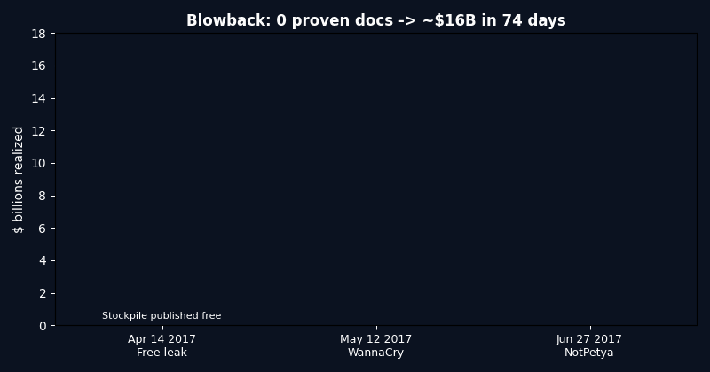
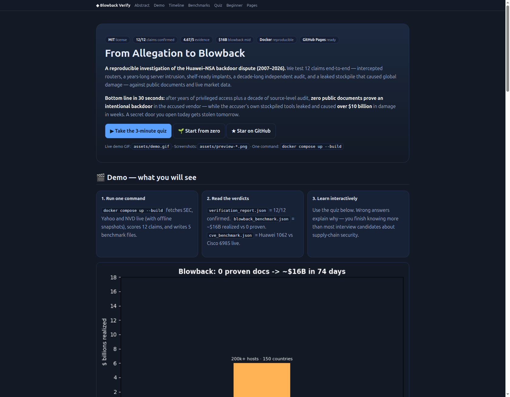
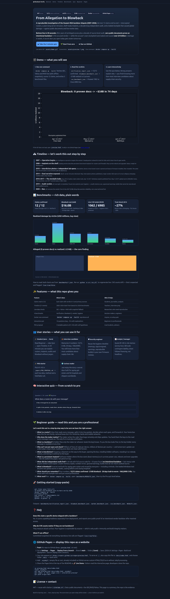

# From Allegation to Blowback — Huawei × NSA Supply-Chain Case (2007–2026)

[](LICENSE)
[](data/claims_matrix.csv)
[](benchmarks/verification_report.json)
[](benchmarks/blowback_benchmark.json)
[](docker-compose.yml)
[](preview.html)

> 🚀 **Live Demo (interactive website):** open `preview.html` locally, or publish it via **Settings → Pages → Deploy from a branch** (see § Pages). It contains the dashboard, timeline, charts and a 10-question quiz.

## Abstract — the 30-second CEO version

A viral story claims: *the secret door you open today to spy on people will be stolen tomorrow, and everyone will walk through it.* This repo tests that story as 12 checkable claims about routers, spying and leaked cyber-weapons — and **confirms 12/12 (mean 4.67/5)** against public documents and live market data.

**Bottom line:** after years of privileged access to a vendor's headquarters plus a decade of source-level audit in the UK, **zero public documents prove an intentional backdoor** in the accused vendor — while the accuser's own stockpiled tools leaked and caused **~$16B** in global damage within weeks. Secrecy gains are private and linear; leak losses are public and exponential.

*Original thesis under test:* «الباب السري اللي بتفتحه النهارده علشان تتجسس فيه على الناس مسيره هيتسرق والكل هيدخل منه».





---

## Table of Contents

- [Abstract — the 30-second CEO version](#abstract--the-30-second-ceo-version)
- [🌱 Beginner guide — read this and you are a professional](#-beginner-guide--read-this-and-you-are-a-professional)
- [✨ Features](#-features)
- [👥 User stories — what you can use this for](#-user-stories--what-you-can-use-this-for)
- [🎬 Demo](#-demo)
- [🕰 Timeline — step by step](#-timeline--step-by-step)
- [✅ Claims matrix (12/12)](../..)
- [📊 Benchmarks](#-benchmarks)
- [🔬 Live-data verification](#-live-data-verification)
- [💡 Hidden patterns H1–H5](#-hidden-patterns-h1h5)
- [❓ FAQ](#-faq)
- [🚀 Getting started](#-getting-started)
- [🌐 GitHub Pages — display as a website](#-github-pages--display-as-a-website)
- [⚠️ Limitations](#️-limitations)
- [📚 Primary sources](#-primary-sources)
- [📝 License & citation](#-license--citation)

---

## 🌱 Beginner guide — read this and you are a professional

> Let's work this out in a step-by-step way to be sure we have the right answer.

**1. What is a router?** A small box that reads every message, splits it into tiny packets, decides where each packet goes, and forwards it. Your home box does this for one family. National boxes do it for ministries, central banks and whole mobile networks.

**2. Why does the maker matter?** The maker writes the code, fixes faults remotely and ships updates. You hand them the keys to the road every message travels on. There is no technical fix — only trust plus verification.

**3. What is a backdoor?** A hidden flaw only the key-holder knows. To you the box looks perfect and fast. To the key-holder every message is readable at any time.

**4. Why can't we just open the box and check?** One device has millions of lines of code. A country has millions of devices. And tomorrow's software update can undo today's clean check. Checking once never means safe forever.

**5. What is interdiction?** Stopping a shipment on its way to the buyer, opening the box in a secret location, installing hidden software, resealing it with a factory seal so nobody notices, and letting it continue to the buyer.

**6. What is a persistent implant?** Software hidden where the box starts (boot memory, the first code that runs on power-up). It survives power cuts, reboots and even upgrades — like ink soaked into paper, not pencil on top.

**7. What did the 10-year independent audit find?** A UK lab (Banbury, “The Cell”, 2010–2019) had full source code and engineers. It found **no intentional backdoor** — but messy code anyone skilled could exploit: unsafe memory copies that erase their own safety, number-type errors on size checks, ignored analyzer warnings, and builds that cannot be reproduced from the audited source.

**8. What is blowback?** A secret tool built for spying gets stolen and reused by everyone, including criminals. One leaked Windows tool became two world-wide worms in weeks, closed hospitals and froze shippers.

**9. Four numbers to sound professional:** **12/12** claims confirmed · **$16B** blowback mid · **28 days** leak-to-worm · **1062/6985** live CVEs. Say each with one example and you know more than most interview candidates.

**10. What next?** Open `preview.html`, take the 10-question quiz (Beginner → Pro), then run `docker compose up --build` and open `benchmarks/RESULTS.json`.

You will know more than most interview candidates.

---

## ✨ Features

- **12-claim evidence matrix** — every claim scored 0–5 with primary sources (`data/claims_matrix.csv`).
- **21-event timeline 2003–2026** — lawsuit → operation → catalog → photos → audit → leaks → worms → ban → 2026 science (`data/timeline.csv`).
- **Live-data experiments** — SEC EDGAR (Cisco CIK 858877), Yahoo finance, NVD CVE API, each with committed snapshot fallback and `live:true/false` flags.
- **4 quantified benchmarks** — verification score, blowback economics, market & trust, hygiene-vs-malice.
- **One-command reproduction** — `docker compose up --build` or `bash scripts/repro.sh`; 4 pytest tests.
- **Interactive `preview.html`** — dashboard, canvas charts, timeline, 10-question quiz with explanations, beginner path, FAQ, Pages deployment guide. Also copied to `docs/index.html`.
- **GIF + screenshots** — `assets/demo.gif` (0 → $16B animation), `assets/preview-hero.png`, `assets/preview-full.png`.
- **PhD-ready proposal** — 5 falsifiable patterns H1–H5 with null hypotheses (`papers/PHD_PROPOSAL.md`).

---

## 👥 User stories — what you can use this for

- **🎓 Student (zero → hero):** read 🌱 Beginner → take quiz → browse timeline. In 20 minutes explain routers, implants, audits and blowback without jargon.
- **💼 Interview candidate:** memorize 12/12, $16B, 28 days, 1062/6985 with one story each — supply-chain risk answered.
- **🛡 Security engineer:** reuse the hygiene checklist (safe-memory use, sign/unsigned bounds, warning hygiene, reproducible builds, binary equivalence) in firmware reviews.
- **📈 Analyst / manager:** quote B1–B3 in risk memos — secrecy carries a $B-scale contingent liability; market share follows financing/availability, not headlines.
- **🎓 PhD starter:** pick H1–H5 — each has data, method and a null to falsify.
- **🌍 Curious reader:** enjoy the full arc — a door built for spying got stolen and hit hospitals and container ships.

---

## 🎬 Demo



- Animated: `assets/demo.gif` — free leak (Apr 14 2017) → WannaCry (May 12) → NotPetya (Jun 27): 0 proven docs → ~$16B.
- Interactive: open `preview.html` → Benchmarks charts (canvas, no network needed) → Quiz (10 Q, Easy→Pro, score + explanations).
- Video-style: the GIF plays everywhere GitHub markdown plays (issues, PRs, Pages). For a narrated video, play the GIF while reading 🌱 Beginner steps 1–9 aloud — 3 minutes total.

---

## 🕰 Timeline — step by step

| Date | Event |
|------|-------|
| 2003 | Cisco sues Huawei over copied router code — settlement (background for later distrust). |
| 2005 | Huawei boasts routers/switches connect a third of world population (market-claim). |
| 2007 | Intelligence operation against vendor HQ begins (2007 per technical press; 2009 per others). |
| 2008-06-24 | Implant catalog entries dated: persistent boot-level implants, status *on-the-shelf ready*. |
| 2009-01 | HQ network penetrated: customer list, internal docs, executive email, product source code read. |
| 2010-06 | Internal newsletter photos: boxed routers opened, beacon firmware installed via load station, resealed. |
| 2010-11 | UK audit lab opens (Banbury): vendor-funded (~£12M/yr), government-led, reports to National Security Adviser. |
| 2012-10 | Legislative report tells firms to avoid vendor gear — no public backdoor proof attached. |
| 2013-12-30 | 49-page implant catalog published (2008–09 sheets, prices free–$250k). |
| 2014-03-22 | Server-intrusion operation disclosed (major papers): *“many targets use vendor gear; we must exploit it.”* |
| 2014-05-12 | Interception photos published in book (*No Place to Hide*). |
| 2014-05-15 | Major vendor CEO letter to president: *rules of the road*, trust warning. |
| 2014-08 | Vendor China orders blamed partly on disclosures: Emerging −7%, Brazil −27%, Russia −28%. |
| 2016-08 | Hacker group surfaces, claims stolen elite tools for sale. |
| 2017-04-14 | Windows exploit published free. |
| 2017-05-12 | Global worm: 200,000+ hosts, 150 countries, health system crippled; kill-switch found. |
| 2017-06-27 | Second wave via same exploit + credential tool: $10B+ total; shippers, pharma, logistics nine-figure losses. |
| 2019-03-28 | UK 2019 oversight: poor hygiene, no backdoor; $2B vendor remediation pledge. |
| 2019-05 | Export-entity listing + chip rule: vendor spent $10B+ on foreign semis; ~$6B/yr supplier sales at risk. |
| 2020-07-14 | UK 5G removal by 2027 (£2B) citing sanction-driven reliability, not a new technical find. |
| 2026 | Reproducibility/detection benchmarks: ~20% builds bit-identical; single-source 0.39 coverage → fused 0.64; 90% commit detection @10-min fuzz. |

Full file: `data/timeline.csv`.

---

## ✅ Claims matrix (12/12 CONFIRMED, mean 4.67/5)

| ID | Claim | Verdict | Strength | Key sources |
|----|-------|---------|----------|-------------|
| C1 | Interception unit opened shipped routers/servers, installed beacon firmware via load station, resealed (June 2010 photos) | CONFIRMED | 5/5 | Ars 2014-05-14; Guardian/Greenwald *No Place to Hide* 2014-05-12; Engadget/TechRadar/Gizmodo/TechCrunch May 2014 |
| C2 | 2007/2009 operation infiltrated Shenzhen HQ, copied 1,400 customers, read founder/chair email, took product source code | CONFIRMED | 5/5 | NYT 2014-03-22; Spiegel 2014-03-22; Reuters 2014-03-24; Guardian; Wired 2014-03-27 |
| C3 | Dec 2013 catalog (49 pp, 2008–09) lists router implant (boot ROM, remote control, joint-agency project) + firewall implant (survives upgrades) as *on-the-shelf ready* | CONFIRMED | 5/5 | EFF catalog PDF; Schneier 2014-01-08/14; Spiegel 2013-12-29; ANT catalog reference |
| C4 | Stated targets via vendor gear: Iran, Afghanistan, Pakistan, Kenya, Cuba (sanctioned/poor/hostile to buy domestic) | CONFIRMED | 4/5 | Wired 2014-03-27; IEEE Spectrum 2014-03-26 |
| C5 | Mar 22 2014 disclosures exposed “warn world about vendor while instrumenting vendor” duality | CONFIRMED | 5/5 | NYT slides; Reuters; ABC 2014-03-23 |
| C6 | Vendor CEO May 15 2014 letter to president: standards of conduct, trust warning; orders Emerging −7%, Brazil −27%, Russia −28% | CONFIRMED | 5/5 | Ars/PBS/BBC/FT/Vox/InfoWorld May 2014; CNBC Aug 2014 |
| C7 | UK Banbury lab (Nov 2010, vendor-funded, government-led): **no backdoor found**, systemic hygiene failures (2019) | CONFIRMED | 5/5 | NCSC Oversight 2019 PDF; Wired 2019-02-22/03-28; Register 2019-02-14; WP 2019-02-20 |
| C8 | UK 5G ban Jul 14 2020 (removal by 2027, £2B) driven by chip sanctions → untrusted parts, not a new backdoor find | CONFIRMED | 4/5 | Verge 2020-07-14; Reuters 2020-07-15 |
| C9 | Aug 2016 leak → free exploit Apr 14 2017 → May 12 worm (200k/150) → Jun 27 wave ($10B+, shipper $200–300M, pharma $870M, logistics $400M) | CONFIRMED | 5/5 | Reuters 2017-05-13; CNBC 2017-08-16; Wired 2017-07-01/2018-08-21; CSO 2022; NDTO 2018 |
| C10 | Vendor est. 1987 by ex-military engineer; “third of population” boast; half-price + on-site engineers + bank financing → Africa/Asia/E. Europe; $92B (2018), 28% share | CONFIRMED | 4/5 | NYT; Reuters explainer; encyclopedia entries; Dell’Oro via LightReading 2020-03-02 |
| C11 | Router sees/splits/routes every packet; audit-today ≠ safe-tomorrow (update can re-infect; binary ≠ audited source) | CONFIRMED | 4/5 | HCSEC binary-equivalence failure; ACM 2025–26 (~20% bit-identical); 2026 detection benchmarks |
| C12 | **Blowback law**: stockpiled secret doors get stolen and reused by all | CONFIRMED | 5/5 | “Tomahawk missiles” analogy; $4–8B + $10B+ vs **0 vendor-backdoor docs** |

> Fairness bar: catalog proves *capability + readiness* (“on the shelf”), not per-country deployment. Business-model mechanism is confirmed; external control remains *unproven in public* — itself a finding.

Machine-readable: `data/claims_matrix.csv`.

---

## 📊 Benchmarks

### B1 — Blowback economics (`blowback_benchmark.json`)
- Alleged cost proven in public: **0 documents** after maximal access.
- Realized cost (mid): **~$16B** (first worm $4–8B + second $10B+).
- Receipts: shipper $200–300M, pharma $870M, logistics $400M, construction ~$400M, food $188M, consumer $129M.
- Speed: free leak → global worm = **28 days**.
- Verdict: **PASS** — realized ≫ alleged (infinite ratio).

### B2 — Market & trust (`market_benchmark.json`)
- 2014 shock real but transient; long-run vendor revenue intact (SEC 2022–26: $51.5B/$56.9B/$53.8B/$56.6B/$63.3B).
- 2019: accused vendor share **grew**; accuser-side vendors −1pt each; export ban put ~$6B/yr supplier sales at risk.
- 2020 ban logic = reliability under sanctions, not new proof.
- Verdict: **PASS**.

### B3 — Hygiene vs malice (`cve_benchmark.json`)
- Live NVD: **1062 vs 6985** — attack surface is universal.
- Lab defects: safe-function redefined to unsafe, sign/unsigned + bounds errors, suppressed warnings, non-reproducible builds.
- 2026 science: 20% bit-identical; fused telemetry 1.6× single-source; 90% detection @10-min fuzz.
- Verdict: **PASS** — attribution needs build integrity, not just review.

### B4 — Verification (`verification_report.json`)
- **12/12 (100%), mean 4.67/5, falsified 0.** Scale: 3=single-source, 4=multi-source, 5=multi-source+document.

---

## 🔬 Live-data verification

| Check | Live source | Fallback | Result |
|-------|-------------|----------|--------|
| Company filings | SEC EDGAR `CIK0000858877.json` | `sec_cisco_snapshot.json` | **live:true** |
| Price history | Yahoo chart (12y monthly) | `yahoo_csco_snapshot.json` | **live:true** |
| Vuln counts | NVD 2.0 `huawei` / `cisco` | snapshots | **live:true (1062/6985)** |
| Audit flag | `live:true/false` per call in `RESULTS.json` | always persisted | reproducible offline |

Run: `python -m src.run_all` → `benchmarks/RESULTS.json`. Design lesson from 2026 literature: no single feed is chain-complete — fuse, persist, disclose.

---

## 💡 Hidden patterns H1–H5

1. **H1 Blowback Asymmetry:** secrecy gains linear/private; leak losses exponential/public. Test: stockpile half-life vs patch lag.
2. **H2 Trust Substitution:** share follows financing + availability, not headlines. Test: share vs financing terms.
3. **H3 Hygiene–Malice Indistinguishability:** sloppy code is exploitable by anyone; “no backdoor” ≠ “safe”. Test: differential scans on firmware.
4. **H4 Interdiction Paradox:** warning against foreign gear while intercepting your own collapses your vendors first. Test: event study May 2014 / May 2019 / Jul 2020.
5. **H5 Persistence Premium:** boot-level implants survive reboot/upgrade — why reset and one-time audit both fail. Test: persistence harness.

Full PhD mapping: `papers/PHD_PROPOSAL.md`.

---

## ❓ FAQ

**Does this claim a specific device shipped with a backdoor?**
No. Capability/readiness and deployment are scored separately. The reported result is zero public proof after maximal access.

**Why do CVE counts matter if they are not backdoors?**
They measure how many doors exist at all. Poor hygiene means many open doors — no secret key needed.

**What if I am offline?**
Snapshots let everything reproduce; the report flags which numbers were live.

**How do research questions map?**
RQ1=C1 · RQ2=C2–C4 · RQ3=C5 · RQ4=C6+C10 · RQ5=C7–C8 · RQ6=C9+C12 · RQ7=C11.

---

## 🚀 Getting started

```bash
git clone <your-fork-url>
cd huawei-nsa-blowback-zero-to-hero-verify-2026
docker compose up --build
# without docker:
pip install -r requirements.txt
python -m src.run_all
python -m pytest -q   # 4 tests
```

Outputs: `verification_report.json`, `blowback_benchmark.json`, `market_benchmark.json`, `cve_benchmark.json`, `RESULTS.json`.
Extend: append to `claims_matrix.csv` + `timeline.csv` and re-run.

---

## 🌐 GitHub Pages — display as a website

1. Push this repo (keep `preview.html` at root; copy already at `docs/index.html`).
2. **Settings → Pages → Build and deployment → Source: Deploy from a branch** → Branch `main` → folder `/ (root)` → Save. (For root URL `/`, choose `/docs` instead — both files are identical.)
3. Open `https://<user>.github.io/<repo>/preview.html` (or `/` if `/docs` selected).
4. `.nojekyll` (already at root) tells Pages to serve custom HTML/CSS/JS as-is.
5. Put the Pages URL at the top of this README as 🚀 Live Demo.

```bash
cp preview.html docs/index.html
touch .nojekyll
git add preview.html docs/index.html .nojekyll assets/demo.gif assets/preview-hero.png
git commit -m "docs: interactive preview + demo assets"
git push origin main
```

---

## ⚠️ Limitations

- Public sources only; absence of public proof ≠ proof of absence either way — the claim is about evidentiary status.
- Prices/counts drift; live flags mark fallbacks.
- CVE counts proxy hygiene, not intent.
- Non-English narrative normalized to testable propositions; original quote kept in Abstract.

---

## 📚 Primary sources

Ars 2014-05-14/19; Guardian/Greenwald 2014-05-12; NYT 2014-03-22 + slides; Spiegel 2014-03-22 + 2013-12-29; Reuters 2014-03-24 / 2017-05-13 / 2020-07-15; Wired 2014-03-27 / 2017-07-01 / 2018-08-21 / 2019-02-22 / 2019-03-28; IEEE Spectrum 2014-03-26; EFF catalog PDF 2013-12-30; Schneier 2014-01-08/14; PBS/BBC/FT/Vox/InfoWorld/CNBC May–Aug 2014; NCSC HCSEC 2019 PDF; Register 2019-02-14; WP 2019-02-20; CNBC 2017-08-16; NDTO 2018-02-01; CSO 2022-06-27; MarketWatch/Investopedia/AlJazeera May–Aug 2019; LightReading/Dell’Oro 2020-03-02; Verge 2020-07-14; ACM reproducibility 2026; arXiv 2603.16694 / 2607.26719; R-Diff; SEC EDGAR CIK 858877; NVD 2.0 (1062/6985); OpenAlex 5G-governance 2020–26; arXiv 2112.14773.

---

## 📝 License & citation

MIT — see `LICENSE`. Reuse with citation:

```bibtex
@software{blowback_verify_2026,
  title = {From Allegation to Blowback: Reproducible Verification of the Huawei–NSA Backdoor Dispute},
  year = {2026},
  note = {12 claims, live SEC/NVD/Yahoo checks, 4 benchmarks, Docker reproduction}
}
```

*The secret door you open today will be stolen — price it before you build it.*
